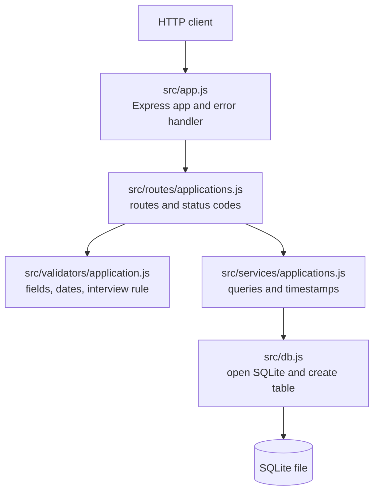

# Job Application Tracker API

A small REST API for recording job applications. It stores each application in a SQLite file, validates incoming JSON, and keeps the data after the server restarts. There is no frontend and no authentication.

## Features

- Create, read, update, and delete a job application.
- List every application, or filter the list by status.
- List upcoming interviews, earliest date first.
- Reject unknown fields, malformed ids, and impossible calendar dates.
- Require `interview_date` when the resulting status is `interview_scheduled`.
- Leave stored data unchanged when validation fails.

## Tech Stack

- Node.js 22.13 or newer, using the built-in `node:sqlite` module
- Express 4
- SQLite, stored as a file
- `node:test` for the automated API tests

Express is the only external dependency.

## Prerequisites

- Node.js 22.13 or newer
- npm

Check the installed versions with `node --version` and `npm --version`. The API uses `node:sqlite`, which is not available in Node.js 20.

## Installation

From the project directory:

```bash
npm install
```

## How to Start the Server

```bash
npm start
```

The server listens on port 3000. Open `http://localhost:3000`.

The database file is created at `data/applications.db`. Its directory is created if it does not exist.

Optional environment variables:

| Variable | Default | Purpose |
|---|---|---|
| `PORT` | `3000` | Port to listen on |
| `DATABASE_PATH` | `data/applications.db` | SQLite file path |

`DATABASE_PATH` may be absolute or relative to the directory where the process is started. The parent directory is created when needed.

## How to Run Automated Tests

```bash
npm test
```

The tests start the real Express routes against temporary SQLite files, then close the database and delete those files. They do not use `data/applications.db`.

## REST API

Base URL: `http://localhost:3000`

| Method | Path | Success | Description |
|---|---|---|---|
| `POST` | `/applications` | 201 | Create one application |
| `GET` | `/applications` | 200 | List all applications, newest id first |
| `GET` | `/applications?status=applied` | 200 | List applications with one status |
| `GET` | `/applications/upcoming-interviews` | 200 | Upcoming interviews, earliest date first |
| `GET` | `/applications/:id` | 200 | Retrieve one application |
| `PATCH` | `/applications/:id` | 200 | Update the supplied fields |
| `DELETE` | `/applications/:id` | 204 | Permanently delete one application |

Status values are `applied`, `interview_scheduled`, `offer`, `rejected`, and `withdrawn`.

Client fields are `company_name`, `job_title`, `status`, `applied_date`, `interview_date`, and `notes`. The server sets `id`, `created_at`, and `updated_at`. Text fields are trimmed. A blank `notes` value is stored as `null`.

Dates use `YYYY-MM-DD` and must be real calendar dates. `applied_date` is required. `interview_date` may be omitted unless the resulting status is `interview_scheduled`. An update is checked after the new fields are merged with the stored row, so clearing the date of an interview that is still scheduled returns 400 and does not save.

`GET /applications/upcoming-interviews` returns rows whose status is `interview_scheduled` and whose `interview_date` is today or later. Today is the UTC calendar date, not the server's local timezone. Results are ordered by `interview_date`, then `id`. Past interviews and other statuses are left out of this list, but they remain available from `GET /applications`.

| Situation | Status | Body |
|---|---|---|
| Validation failure | 400 | `{ "error": "Validation failed", "details": [...] }` |
| Malformed id | 400 | `{ "error": "Validation failed", "details": [...] }` |
| Invalid JSON | 400 | `{ "error": "Request body must be valid JSON" }` |
| JSON body larger than 100 KB | 413 | `{ "error": "Request body is too large" }` |
| Unknown route or missing application | 404 | `{ "error": "Not found" }` or `{ "error": "Application not found" }` |
| Successful delete | 204 | Empty |

## Example Requests and Responses

Create an application:

```bash
curl -X POST http://localhost:3000/applications \
  -H "Content-Type: application/json" \
  -d '{"company_name":"Example Ltd","job_title":"Graduate Software Engineer","status":"applied","applied_date":"2026-11-20"}'
```

```json
{
  "id": 1,
  "company_name": "Example Ltd",
  "job_title": "Graduate Software Engineer",
  "status": "applied",
  "applied_date": "2026-11-20",
  "interview_date": null,
  "notes": null,
  "created_at": "2026-11-23T06:18:46.884Z",
  "updated_at": "2026-11-23T06:18:46.884Z"
}
```

Schedule an interview:

```bash
curl -X PATCH http://localhost:3000/applications/1 \
  -H "Content-Type: application/json" \
  -d '{"status":"interview_scheduled","interview_date":"2026-12-02"}'
```

A missing interview date is rejected. The stored row is not changed:

```json
{
  "error": "Validation failed",
  "details": [
    {
      "field": "interview_date",
      "message": "interview_date is required when status is interview_scheduled"
    }
  ]
}
```

List upcoming interviews:

```bash
curl http://localhost:3000/applications/upcoming-interviews
```

A missing id returns:

```json
{ "error": "Application not found" }
```

## Architecture



`src/server.js` chooses the port and database path, opens the file, and starts listening. Tests import `createApp` directly and do not start `src/server.js`.

## Database Schema

```sql
CREATE TABLE IF NOT EXISTS applications (
  id             INTEGER PRIMARY KEY AUTOINCREMENT,
  company_name   TEXT NOT NULL,
  job_title      TEXT NOT NULL,
  status         TEXT NOT NULL,
  applied_date   TEXT NOT NULL,
  interview_date TEXT,
  notes          TEXT,
  created_at     TEXT NOT NULL,
  updated_at     TEXT NOT NULL
);
```

SQLite has no date type. Dates are stored as `YYYY-MM-DD` text, and timestamps are UTC ISO-8601 strings. All request values are passed to SQLite through prepared statements. The update statement only interpolates column names from a fixed list.

## Design Decisions

- The status list is fixed: `applied`, `interview_scheduled`, `offer`, `rejected`, `withdrawn`.
- `interview_date` is required only when the merged record has status `interview_scheduled`. Other statuses may keep a date. Changing the status does not delete that date.
- Upcoming interviews use the UTC date so the result does not depend on the machine's local timezone.
- `applied_date` may be in the future.
- Unknown JSON fields are rejected instead of being ignored.
- An id that is not a positive integer returns 400. A well-formed id that is missing returns 404.
- Delete is permanent.
- The database module is `node:sqlite`, so the project does not need a native addon.

## Known Limitations

- There is no authentication. The server accepts connections on the machine's network interfaces. Run it locally and do not expose the port to an untrusted network.
- The list endpoints return every matching row. There is no pagination.
- Upcoming interviews use the UTC calendar date. Hong Kong is UTC+8, so in the early morning the UTC date can still be the previous day. An interview dated that previous day is still treated as upcoming until 08:00 Hong Kong time.
- Node.js older than 22.13 cannot run the project.
- A JSON body larger than the parser limit of 100 KB returns 413.
- The process keeps one database connection open until it exits.
